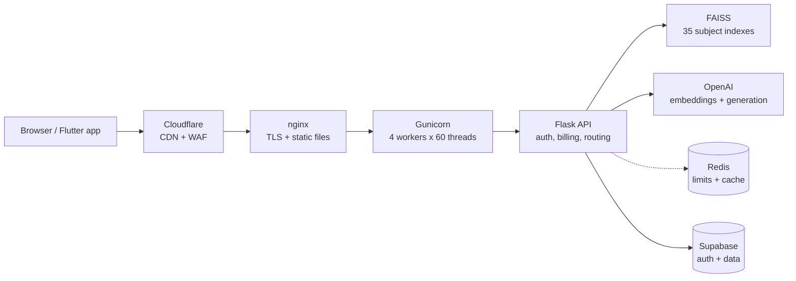

<!-- Animated Header -->
<h1 align="center">

</h1>

<h2 align="center">AI Engineer &nbsp;|&nbsp; RAG &amp; LLM Systems &nbsp;|&nbsp; Computer Vision &nbsp;|&nbsp; Backend &nbsp;|&nbsp; Automation</h2>

  
  
  

  

---

# 🚀 About Me

I'm an **AI Engineer** who likes owning a system from the model all the way to production: retrieval and prompt design, the API, the web and mobile clients, and the server it runs on.

- 🎓 **B.Sc. Computer Science (AI track)**, Cairo University, 2025
- 🏗️ Built and run **[Grownerd](https://grownerd.net)**, a live RAG study assistant for the Syrian national curriculum, grades 9 to 12. Solo, end to end
- 🧪 Computer vision (handwriting recognition, deepfake classification) and workflow automation with n8n
- 🛡️ I care about the unglamorous parts: rate limiting, backups, security audits, and failing loudly instead of silently
- 📚 Andrew Ng's **Machine Learning Specialization** and **CNNs**, University of Michigan's **Applied Data Science with Python**
- 🌍 **Open to remote and freelance work** in AI, LLM systems and automation

---

# ⚡ Snapshot

<table align="center">
  <tr>
    <td align="center"><h1>35</h1>subject indexes (FAISS, one per textbook)</td>
    <td align="center"><h1>240</h1>concurrent requests on a 4 GB server</td>
    <td align="center"><h1>$0.0006</h1>per answered question</td>
    <td align="center"><h1>174</h1>backend tests</td>
  </tr>
</table>

---

# 🌟 Featured Projects

## 🎓 [Grownerd](https://grownerd.net): production RAG platform for Syrian students

> An AI study assistant that answers from **the actual textbook page**, not from general model knowledge. Built solo, live in production, 86,000+ lines across four codebases.

**What it does**
- **Ask mode**: answers grounded in retrieved textbook text for 35 subjects, grades 9 to 12
- **Test mode**: generates curriculum-aligned quiz questions, with question numbering enforced in code rather than left to the model
- **Page mode**: open any textbook page and get an explanation, cached so a page is explained once for all students

**How a request flows**

**Engineering highlights**

| Area | What I did |
|---|---|
| 🔎 Retrieval | 35 independent FAISS indexes built from textbook pages, with lesson- and page-level metadata |
| 🤖 Models | `text-embedding-3-large` for retrieval, `gpt-4o-mini` for generation, tuned to about $0.0006 per question |
| 🧾 Billing | Atomic token deduction in SQL, so concurrent requests can't overspend a quota |
| 🚦 Limits | Per-endpoint rate limits on Redis, with a measured in-memory fallback when Redis is down |
| 🔐 Security | Row-level security on every table, identity derived from the verified token (never from the request body), startup validation that refuses to boot on unsafe config |
| 🖥️ Server | Gunicorn gthread, nginx, Cloudflare in front, origin locked to Cloudflare, fail2ban jails, three monitors alerting on Telegram |
| 💾 Backups | Daily full dump with integrity check, uploaded to Cloudflare R2, 14-day rotation |
| 📱 Clients | Next.js static web app (RTL Arabic, KaTeX math, per-subject symbol keyboards) and a Flutter mobile app on the same API |
| 🧪 Quality | 174 tests; traced a LaTeX escaping defect in 9 of 35 data files back to the source CSVs |

`Python` `Flask` `FAISS` `OpenAI` `Supabase` `Redis` `Next.js` `TypeScript` `Flutter` `Docker` `nginx` `Cloudflare`

---

## 💊 [PharmaScan](https://github.com/motaha123/pharama_scan_app): handwritten prescription recognition

End-to-end pipeline that reads medicine names from handwritten prescriptions.

- OpenCV preprocessing: grayscale, noise removal, adaptive thresholding, character segmentation
- **Tesseract OCR** combined with a **VGG16 transfer-learning** classifier to lift accuracy on handwriting
- Recommendation engine with fuzzy matching for alternative medicines and interaction alerts
- n8n automation for ingestion and retraining, Docker containerization

`Python` `TensorFlow` `OpenCV` `Tesseract` `n8n` `Docker`

---

## 🧠 Deepfake Image Classification

CNN model that classifies real versus deepfake images.

---

## 🛢️ Syria Fuel Tracker *(in progress)*

An open, source-per-row dataset of Syrian fuel price decisions from 1970 to 2026. Prices converted at the parallel-market rate, every row carries its sources and an honest verification status, and the messy gaps stay visible instead of being smoothed over.

---

# 💼 Experience

**AI Engineering Intern, Codenza** &nbsp;·&nbsp; *Oct 2025 to Jan 2026*
- Built and optimised AI automation workflows, integrating ML and deep learning models into production-ready systems
- Fine-tuned computer vision models; automated data pipelines and retraining with n8n and Docker
- Built automation around third-party AI video-generation tools and presented results to stakeholders

---

# 🛠️ Tech Stack

### 🔹 Languages

  

### 🔹 AI, Data & Backend

  

### 🔹 Web, Infrastructure & Tools

  

<b>Full list</b>

- **GenAI & LLM:** RAG architecture, FAISS vector search, embeddings, prompt engineering, OpenAI API
- **ML & DL:** TensorFlow, Keras, PyTorch, Scikit-learn, transfer learning (VGG16, MobileNet), hyperparameter tuning
- **Computer Vision:** OpenCV, preprocessing, segmentation, OCR (Tesseract)
- **Data:** Pandas, NumPy, Matplotlib, Seaborn, Jupyter
- **Backend & APIs:** Flask, REST design, Supabase, PostgreSQL, Redis, authentication, rate limiting
- **Infrastructure:** Docker, nginx, Gunicorn, Ubuntu, Cloudflare, systemd, fail2ban, n8n

---

# 🎓 Education & Certifications

| | |
|---|---|
| 🎓 **B.Sc. Computer Science** | Cairo University, 2021 to 2025 (AI, ML, Computer Vision, Data Science) |
| 📜 Machine Learning Specialization | Andrew Ng, Coursera |
| 📜 Convolutional Neural Networks | Andrew Ng, Coursera |
| 📜 Applied Machine Learning in Python | University of Michigan |
| 📜 Applied Text Mining in Python | University of Michigan |
| 📜 Applied Data Visualization with Python | University of Michigan |
| 📜 Applied Social Network Analysis in Python | University of Michigan |
| 📜 Introduction to Data Science | University of Michigan |

**Languages:** Arabic (native) · English (fluent) · French (basic)

---

# 🎯 What I'm Working Toward

- Building production LLM and RAG systems, and learning to measure them properly (evaluation, failure modes, cost)
- Open datasets and studies that matter locally, done with honest sourcing
- Remote and freelance AI work

---

# 📊 GitHub Stats

  
  

  

  

  

---

# 🌐 Connect with Me

  
  
  

